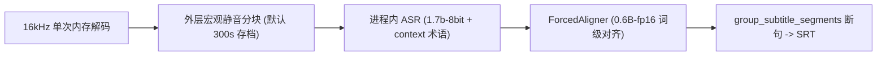

# mlx-asr-pipeline

[](https://github.com/RichardLitt/standard-readme)

> 基于 `mlx-qwen3-asr` 在 Apple Silicon 上构建的纯原生语音识别与词级强制对齐字幕流水线。

本仓库提供两个独立命令行工具：`mlx-asr-pipeline` 用于本地单进程音视频转写与词级时间轴对齐输出 `.srt` 字幕；`yt-cookies` 用于从 Ego Browser 安全导出临时 YouTube 会话凭证。

## 目录

- [背景](#背景)
- [安装](#安装)
- [用法](#用法)
- [开发检查](#开发检查)
- [贡献与安全](#贡献与安全)
- [许可证](#许可证)

## 背景

本流水线在单进程内直接调用 `mlx_qwen3_asr.Session` 执行解码、语音识别与词级强制对齐，不依赖外部推理服务或中间切片文件：



- **进程内零外部服务依赖**：无需启动额外推理守护进程或通过 HTTP 转发音频请求，单次 16kHz 内存解码后直接推理，避免超时与多段临时音频文件 I/O。
- **黄金模型组合**：默认采用 `moona3k/mlx-qwen3-asr-1.7b-8bit` 搭配未量化原版 `Qwen/Qwen3-ForcedAligner-0.6B`，在保持 `float16` 激活计算与时间戳精度的同时控制显存占用。
- **双层静音切分与断点续传**：外层每 `300` 秒按最低能量静音点切分并刷新 `.srt` 与 `checkpoint.json`；内层交给 `mlx-qwen3-asr` 自动按 `<=30` 秒静音点切分并清理 Metal 缓存，同时保留库内默认语言自动检测、动态生成上限与字幕行宽平衡策略。

## 安装

前置条件：搭载 Apple Silicon 的 macOS 设备，已安装 `mise`、`uv` 与 `ffmpeg`（`brew install ffmpeg`）；如需使用 `yt-cookies`，需本机已安装 `ego-browser`。

```sh
mise install
uv sync --locked
```

## 用法

### `mlx-asr-pipeline`

转写音视频并生成字幕文件（进度输出至 `stderr`，产物路径输出至 `stdout`）：

```sh
# 指定英文并注入领域术语提示
uv run mlx-asr-pipeline talk.mp4 -o talk.en.srt -l English -c "Grokbot PStack TLA+ Lean"

# 指定中文或日语（同样支持 en / zh / ja 等常用简写）
uv run mlx-asr-pipeline lecture.mp4 -l Chinese
uv run mlx-asr-pipeline episode.mp4 -l Japanese
```

静音流式输出到 `stdout`（适合脚本与 Agent 调用，避免日志污染上下文）：

```sh
uv run mlx-asr-pipeline talk.mp4 -o - --quiet > talk.en.srt
```

常用选项：

| 选项 | 默认值 | 说明 |
| :--- | :--- | :--- |
| `INPUT` | 必填 | 输入音频或视频文件路径 |
| `-o, --output <PATH>` | `<input_stem>.srt` | 输出 `.srt` 路径；传 `-` 时直接输出到 `stdout` |
| `-l, --language <LANG>` | 自动检测 | 强制指定识别语言（默认遵循库内自动检测）；常用标识：英文 `English`（`en`）、中文 `Chinese`（`zh`）、日语 `Japanese`（`ja`） |
| `-c, --context <TEXT>` | 空 | 领域专有名词或上下文提示，用于在声学解码阶段纠偏术语 |
| `--asr-model <ID>` | `moona3k/mlx-qwen3-asr-1.7b-8bit` | ASR 模型标识或本地目录 |
| `--aligner-model <ID>` | `Qwen/Qwen3-ForcedAligner-0.6B` | ForcedAligner 模型标识或本地目录 |
| `--chunk-seconds <SEC>` | `300` | 断点续传宏观分块时长；设为 `0` 禁用外层分块 |
| `--work-dir <DIR>` | 系统临时目录自动分配 | 指定 `checkpoint.json` 存放目录 |
| `--no-resume` | 关闭 | 忽略已有断点，从头重新转写 |
| `--json` | 关闭 | 向 `stdout` 输出结构化摘要 JSON |
| `-q, --quiet` | 关闭 | 静默 `stderr` 进度日志 |
| `-v, --verbose` | 关闭 | 在 `stderr` 打印分块转写预览 |

### `yt-cookies`

从 Ego Browser 指定 Profile 导出临时 `0600` Netscape Cookie 文件（绝不打印凭证内容）：

```sh
COOKIE_PATH=$(uv run yt-cookies --quiet)
uv run yt-cookies --profile "Profile 1" --json
```

完整下载、静音转写与翻译 SOP 见 [docs/SOP.md](docs/SOP.md)。

## 开发检查

```sh
mise run check
```

## 贡献与安全

请参阅 [贡献指南](CONTRIBUTING.md) 与 [安全政策](SECURITY.md)。

## 许可证

[MIT](LICENSE) © 2026 Taitide Labs
