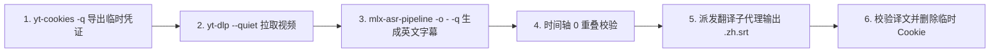

# YouTube 视频下载与字幕生成 SOP

> 基于 Ego Browser、`yt-dlp` 与原生 `mlx-asr-pipeline` 的高清视频拉取及中文字幕制作标准操作规程。

本规程全链路优先采用静音与 `stdout` 管道模式执行，避免冗余进度日志污染终端或 Agent 上下文。

## 目录

- [背景](#背景)
- [前置条件](#前置条件)
- [操作流程](#操作流程)

## 背景

直接拉取 YouTube 视频并依赖平台自动字幕会遇到会话鉴权拦截、JS 挑战解算失败以及滚动字幕时间轴大量重叠的问题。因此流程统一采用：



## 前置条件

- 已在仓库根目录完成 `mise install && uv sync --locked`
- 系统已安装 `ffmpeg`、`bun`、`yt-dlp` 与 `ego-browser`，且目标 Profile 已登录 YouTube

## 操作流程

### 1. 导出临时 Cookie

使用静音模式导出凭证路径（权限 `0600`，不打印 Cookie 明文）：

```sh
COOKIE_PATH=$(uv run yt-cookies --quiet)
```

### 2. 下载最高画质视频

配合 `--quiet --no-progress` 抑制下载进度刷屏：

- **高兼容 MP4（H.264 + AAC，适合 B 站投稿与 QuickTime）**：

```sh
yt-dlp \
  --quiet --no-progress \
  --cookies "$COOKIE_PATH" \
  --js-runtimes bun \
  --remote-components ejs:github \
  -f "bestvideo*[vcodec^=avc1]+bestaudio[ext=m4a]/best[ext=mp4]" \
  --merge-output-format mp4 \
  -o "%(title)s [%(id)s].%(ext)s" \
  "https://www.youtube.com/watch?v=<VIDEO_ID>"
```

- **最高画质无损封装（WebM，AV1 + Opus）**：将 `-f` 替换为 `"bestvideo*+bestaudio/best"` 并移除 `--merge-output-format mp4`。

### 3. 本地原生转写与对齐（静音 `stdout` 模式）

使用 `-o - --quiet` 将结果直接经 `stdout` 重定向到 `.en.srt`，抑制全部 `stderr` 进度日志；遇到技术专有名词时通过 `-c` 注入上下文提示：

```sh
uv run mlx-asr-pipeline "<VIDEO_FILE>" \
  -o - \
  --quiet \
  -l English \
  -c "Lauren Tan Grokbot PStack TLA+ Lean" \
  > "<OUTPUT>.en.srt"
```

如需针对数小时长视频保留断点文件落盘续传，可改用 `-o "<OUTPUT>.en.srt" --quiet`（输出文件路径仍走 `stdout`，`stderr` 保持静默）。

生成后校验时间轴（要求 `zeros: 0` 且 `overlaps: 0`）：

```sh
uv run python -c '
import re, sys
blocks = [b for b in re.split(r"\n\s*\n", open(sys.argv[1], encoding="utf-8").read().strip()) if b.strip()]
ts = [re.findall(r"\d\d:\d\d:\d\d,\d\d\d", b.splitlines()[1]) for b in blocks]
to_ms = lambda s: ((int(s[:2])*60+int(s[3:5]))*60+int(s[6:8]))*1000+int(s[9:12])
ms = [(to_ms(a), to_ms(b)) for a, b in ts]
print("count:", len(ms), "zeros:", sum(e <= s for s, e in ms), "overlaps:", sum(ms[i][1] > ms[i+1][0] for i in range(len(ms)-1)))
' "<OUTPUT>.en.srt"
```

### 4. 派发翻译子代理并清理凭证

按 SMEAC 模板派发翻译子代理（推荐模型 `Gemini 4 Hydrogen (Medium)`），仅传递文件路径引用，不内联全文：

```text
Situation: Technical video English subtitle file at <OUTPUT>.en.srt (speaker/context: <SPEAKER_AND_TERMS>).
Mission: Translate <OUTPUT>.en.srt into natural, concise Chinese Bilibili technical subtitles at <OUTPUT>.zh.srt.
Execution:
1. Read <OUTPUT>.en.srt directly; preserve every cue index and timestamp (HH:MM:SS,mmm --> HH:MM:SS,mmm) 1:1 with no empty cue text and single blank line separators. Do not modify <OUTPUT>.en.srt.
2. Keep technical fidelity without flowery rewriting; keep established English abbreviations and tool names (PR, Agent, TLA+, Lean, React, VS Code). Correct obvious small-model ASR homophone slips using context.
3. Verify <OUTPUT>.zh.srt via Python script: exact cue count and timestamp match against <OUTPUT>.en.srt, zero overlaps, zero empty cues.
Constraints: Silence verbose logs; report only final path and verification counts.
```

完成后立即清理临时 Cookie 文件：

```sh
rm -f "$COOKIE_PATH"
```
